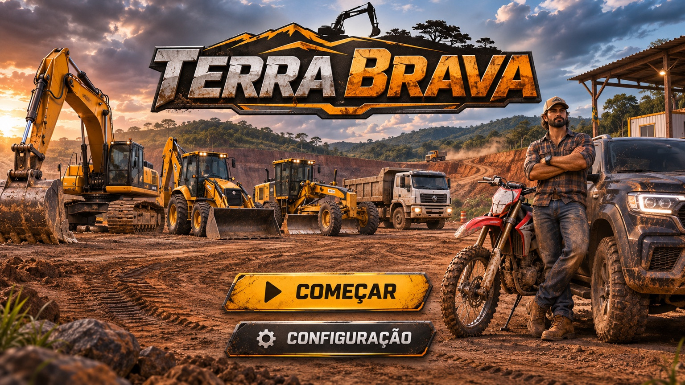

# TERRA BRAVA
**A terra não se move sozinha. Assuma os comandos.**

Simulador brasileiro de máquinas pesadas • Edição Turno de Serra Alta

## 📥 Downloads

| Plataforma | Arquivo | Disponibilidade |
|---|---|---|
| Android | APK | [Versões publicadas](https://github.com/riftsdev/TERRABRAVA-V1/releases) — compilação automatizada |
| iPhone / iPad | IPA | [Versões publicadas](https://github.com/riftsdev/TERRABRAVA-V1/releases) — compilação automatizada; assinatura necessária |
| Windows 64 bits | EXE | [Versões publicadas](https://github.com/riftsdev/TERRABRAVA-V1/releases) — compilação automatizada |
| PC / celular (web) | ZIP | **[Baixar agora](https://github.com/riftsdev/TERRABRAVA-V1/archive/refs/heads/main.zip)** |

Os botões APK, IPA e EXE levam à área de versões. Os arquivos aparecem ali quando a respectiva compilação é concluída e publicada. Acompanhe a [compilação automática](https://github.com/riftsdev/TERRABRAVA-V1/actions). A edição web já está no repositório. O APK de teste usa assinatura de depuração; o EXE não tem assinatura comercial; o IPA precisa de assinatura válida antes de instalar.

## Entre na cabine. Transforme Serra Alta.

Em Terra Brava, o expediente começa com o motor desligado e uma frente de trabalho pela frente. Você assume o lugar do operador: posiciona a máquina, controla a hidráulica, recolhe terra, carrega o basculante e transforma o relevo de Serra Alta até Vila Serra.

O chão não é apenas cenário. A superfície pode ser escavada e nivelada, e a terra despejada fora da carroceria forma aterros. A carga altera o comportamento das máquinas; rampas, lama e curvas exigem cuidado com aderência e tombamentos. Quando o tempo fecha, o trabalho muda junto com o terreno.

Entre um serviço e outro, percorra a região de moto, abasteça a frota com a picape ou desça da cabine para explorar a pé. O objetivo é trazer a rotina da terraplenagem brasileira para um simulador 3D independente, com liberdade para trabalhar do seu jeito.

## Sua garagem

| Máquina | O que fazer |
|---|---|
| Escavadeira hidráulica | Escavar, girar a torre, operar esteiras independentes e carregar caminhões |
| Retroescavadeira | Alternar entre concha dianteira e traseira para escavar e movimentar material |
| Patrol (motoniveladora) | Regular a lâmina e nivelar estradas |
| Caminhão basculante | Transportar até 7 m³ e descarregar material |
| Picape | Transportar diesel e óleo para atender a frota |
| Moto de trilha | Explorar a região e seus diferentes terrenos |

## O que torna Terra Brava diferente

- Terreno deformável e movimentação de material, inclusive fora da área de obra.
- Contrato de nivelamento de 50 metros, com remuneração de até R$ 1.250 dentro do jogo.
- Simulação de massa, tração, derrapagem, transferência de peso e limites hidráulicos.
- Ciclo de dia e noite, chuva, umidade, lama, areia e brita.
- Controles inspirados na operação brasileira: analógico direito para a esquerda fecha a concha; para a direita abre.
- HUD adaptado ao toque, teclado e gamepad, contador de FPS e ajustes gráficos.
- Sons de motor, hidráulica e ambiente, caminhada e salvamento local automático.

## Como jogar a edição web

1. Baixe o ZIP acima e extraia todos os arquivos.
2. Abra `index.html` no navegador do PC, ou sirva a pasta com `python -m http.server 8000` e acesse `http://localhost:8000`.
3. No celular, use uma hospedagem HTTPS ou o endereço do PC na rede local. Jogue em paisagem.

**Teclado:** WASD/setas dirigem, R liga o motor, E entra/sai, C troca câmera, M abre a garagem, J/L fecham/abrem a concha, N altera a chuva e P avança o horário. O manual dentro de Configuração detalha cada máquina.

## Estado do projeto

Versão V1 em desenvolvimento. As funcionalidades descritas constam da documentação e do código do projeto; o desempenho e a compatibilidade dos pacotes nativos ainda precisam de testes em aparelhos reais.

[Manual completo](LEIA-ME.txt) · [Reportar um problema](https://github.com/riftsdev/TERRABRAVA-V1/issues) · [Versões](https://github.com/riftsdev/TERRABRAVA-V1/releases)

**Desenvolvido por riftsdev.**
